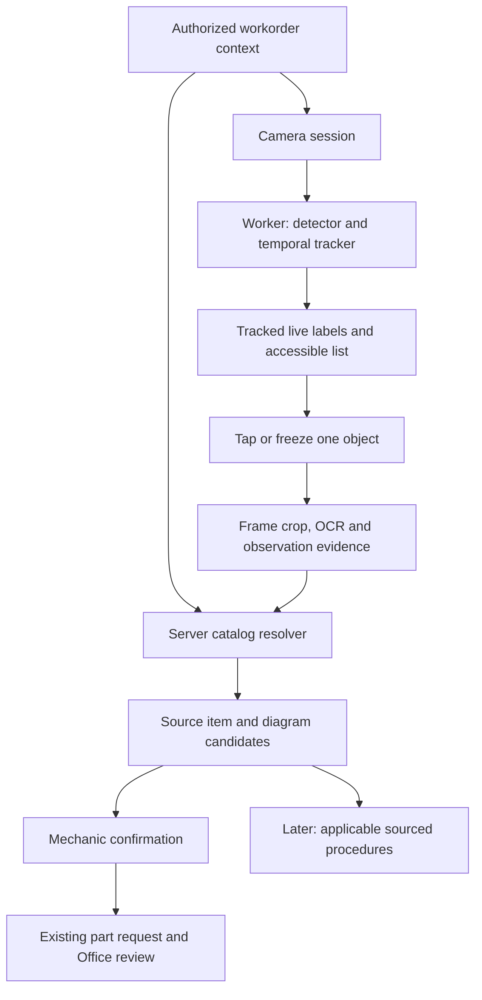

# Live camera parts assistant — research and implementation plan

Research date: October 17, 2026. Status: PLAN ONLY. No camera feature, model training, new integration, migration, deployment or provider purchase is implemented by this document.

## 1. Product decision

Build a workorder-scoped camera assistant that labels supported visible components while the camera is moving. Tapping a label opens that component's evidence, applicable catalog candidates and linked diagram. A mechanic confirms a selection and requests the part through the existing Office workflow. Later, the same component can open sourced inspection, removal, replacement and reassembly procedures.

The requested first product is a live view, not a photo-upload form renamed as live recognition. Captured frames are an internal recognition/evidence mechanism and a fallback. The live version must visibly track labels on real parts on supported physical phones before it is called delivered.

The workorder supplies useful context automatically, but only context the server actually has permission to read and can associate with the correct asset. Missing configuration, old telemetry and imported historical records remain explicitly uncertain. Context improves candidate selection; it cannot make an invisible marking or unknown replacement component certain.

### Three separate claims

| Claim | Example | Required evidence |
|---|---|---|
| Visible component category | Alternator / hose / air cleaner housing | Calibrated vision detection or mechanic-selected region |
| Catalog identity and applicability | Manufacturer + exact number + variant + diagram callout | Approved source record, truck/component applicability and any required label confirmation |
| Procedure applicability | Remove/replace procedure for this installed configuration | Licensed/reviewed procedure edition with applicability, prerequisites and exact specifications |

Detection is not diagnosis. Selecting a component does not establish that it failed or should be purchased. Neither a model score nor an inventory number match proves fitment. A video track ID is not a part number, physical serial or catalog callout number.

## 2. Research findings and technology decision

Primary sources are linked as [S1]–[S15] in section 13. Capabilities below are documented; performance on dirty truck components and the proposed accuracy/latency targets are untested engineering hypotheses.

### 2.1 Real-time labels are technically feasible; truck coverage requires data

MediaPipe's Web Object Detector returns bounding boxes and category results and supports decoded video frames. Its detection calls are synchronous; the documentation recommends workers to avoid blocking the interface [S1]. It needs a compatible trained model. A general-purpose object detector is not automatically trained to distinguish truck assemblies, connectors or similar replacement variants.

Recommended first runtime: browser camera + Canvas/SVG interaction layer + worker-based detector/tracker for a bounded truck-component vocabulary. Keep the model adapter replaceable. Benchmark MediaPipe-compatible and ONNX Runtime Web deployment paths before selecting one; do not install both by default. ONNX offers browser execution backends, but browser/backend/operator support differs, and documentation support tables can lag newer browser implementations [S2]. Probe capabilities and benchmark actual shop devices rather than assuming WebGPU availability.

### 2.2 Segmentation/tracking and naming are different capabilities

SAM 2 provides promptable image/video segmentation; its project states Apache 2.0 licensing for its model checkpoints and relevant code [S3]. It is a candidate for tap-selected masks, video annotation and a server-side comparison baseline, not proof of mobile browser speed or part identity.

The current SAM 3 project also supports concept-based segmentation and video tracking, with newer tracking releases. Its documented reference setup requires a CUDA GPU, and it uses the separate SAM License [S4]. Treat it as a GPU research candidate; verify weights/access, license, resources and measured benefit before selection. Do not assume SAM 3 inherits SAM 2's license or can run on a mechanic's phone.

Grounding DINO is an open-set object-detection candidate for prompted proposals and assisted dataset labeling [S5]. Recognition from prompts still needs truck-specific evaluation. A proposal/mask is not an OEM catalog match. Avoid stacking a large cloud segmentation model on every frame by default.

### 2.3 Use a multimodal model for bounded reasoning and label reading

The existing AI provider can help interpret a selected crop, read labels, name possible component categories and ask a useful follow-up question. General vision models have documented limitations with small text and precise spatial localization [S6]. Therefore they should not own continuous pixel coordinates, final exact part numbers or unsupported repair specifications.

Use independent OCR/label extraction and retain the original crop alongside the extracted text. Verify ambiguous characters, manufacturer namespace and punctuation against source records. A model may propose a category or search query; exact catalog identity is resolved by server-side catalog records.

### 2.4 Use a 2D camera overlay before true 3D AR

Camera video with tracked boxes/masks and clickable labels can be implemented without WebXR. Camera access requires permission and a secure context [S7]. Phone testing against a laptop's plain HTTP LAN address is not equivalent to localhost camera testing; use a valid HTTPS development environment for physical devices.

WebXR has limited browser availability [S8]. True 3D instructions such as arrows attached to a particular hidden fastener require pose/alignment and suitable CAD/scan data. Vuforia Model Targets documents 3D CAD/scan input requirements [S9]. That is a separate later decision, not a prerequisite for the useful 2D product.

### 2.5 Catalog and procedure access are distinct dependencies

PartsProX publicly documents VIN/serial lookup, chassis and major-component diagrams and interactive BOMs [S10]. A supported raw catalog API, headless diagram feed, embedded catalog-only viewer and redistribution rights for our account have not been established.

DTNA documents Excelerator PunchOut and Connect integration options [S11]. These establish integration candidates, not proof that they return diagram coordinates/callouts or allow us to replace the provider's UI. Keep mechanics in our app; Office purchasing remains separate. Do not use background browser scraping, shared dealer cookies or an arbitrary iframe as a production integration.

DTNA's registration overview describes additional resources including technical literature and wiring resources [S12]. A parts catalog does not itself establish access to removal/installation instructions. MOTOR lists service procedures [S15]; Freightliner coverage and usage rights remain unconfirmed.

### Decision summary

Adopt a hybrid design: fast bounded detection/tracking near the camera; sampled-frame recognition/OCR and catalog resolution on the server; a source-backed identity/procedure layer. Do not train a foundation model from scratch, stream every frame to a general LLM, or promise automatic recognition of every truck part.

## 3. Current application audit — source evidence, not runtime proof

Read `docs/ARCHITECTURE.md`, `docs/FRONTEND_OWNERSHIP.md`, the current capability map in `docs/INVENTORY_ODOO_LIVING_RECORD.md`, and `docs/specs/FREIGHTLINER_PARTS_CATALOG_PILOT.md`. Historical sections of the living record are not proof of today's runtime. Source inspection this turn found:

| Existing owner | Reusable capability | Gap/boundary |
|---|---|---|
| `frontend/src/features/inventory/InventoryCodeScanner.jsx`; `inventory-camera-session.js`; `inventory-camera-scanner.js` | Rear camera, autofocus attempt, generation guards, stale-stream cleanup, QR detection and teardown | QR identification, not visual component recognition. Current scanner stops after a decoded code. Preserve exact-unit scanning semantics. |
| `frontend/src/components/workorders/chat/`; `src/server/modules/chat/chat-media.service.js` | Photo capture/attachment path, bounded image validation and integrity metadata | Single images; not a video transport or tracking API. New AI evidence needs its own authorized retention contract, not automatic chat posting. |
| `src/server/modules/chat/chat-part-identification.service.js` | Workorder-derived unit/VIN/make/model/year and available engine context; photo-assisted suggestions; preserves exact mechanic number | No boxes, masks, track IDs, catalog diagram IDs or camera-to-catalog grounding. Engine inference from strings/serial prefixes is a hint, not verified configuration. |
| `src/server/modules/parts-helper/providers/openai.provider.js` | Structured image/text identification, source collection and bounded external calls | Web-assisted suggestions are not manufacturer BOM authority. Its long-running provider path must stay out of the live tracking loop. |
| `src/server/modules/parts-helper/providers/huggingface.provider.js` | General truck-family/model context | Dataset lookup does not establish a VIN-specific build, trained component detector, exact installed part or authoritative fitment. |
| `src/server/modules/parts-helper/parts-helper.service.js`; catalog repository | Workorder-scoped company inventory search; repair suggestions | Company stock catalog is not an OEM diagram catalog. New session routes must derive company/asset from authorized workorder rather than selecting first actor company or trusting client vehicle fields. |
| `src/server/modules/workorders/unit-service-history.service.js`; `service-history.repo.js` | Authorized same-unit history, module access and freshness states | History may be unlinked, stale or unavailable. A service line is not necessarily proof of a currently installed component or repair success. |
| `src/server/integrations/samsara/samsara.sync.service.js`; `samsara.mapper.js` | Vehicle identity, odometer observations and GPS; source/timestamp handling | Current vehicle `STAT_TYPES` are `obdOdometerMeters`, `gpsOdometerMeters`, `gps`. No fault-code history or general engine-sensor ingestion is established by this sync. |
| `src/server/integrations/vin/vpic.client.js` | Basic make/model/year and vehicle-type enrichment | vPIC is vehicle specification decoding [S13], not a parts BOM, installed-configuration registry or visual location map. |
| `frontend/src/components/workorders/MechanicPartRequestForm.jsx`; `frontend/src/components/workorders/part-requests/MechanicPartsSurface.jsx`; `frontend/src/components/workorders/part-requests/OfficeRequestCard.jsx`; `src/server/modules/parts/part.schemas.js` | Exact-number request, quantity/UOM, Office decisions, supply and usage lifecycle | No durable observation/diagram-selection snapshot contract yet. Reuse commands rather than creating an AI purchase path. |

No code or provider configuration was executed to prove model accuracy or completeness of any particular truck's context. No camera footage, telemetry credentials or customer data were sent to AI providers in this research.

## 4. Minimal interaction contract

### Mechanic camera

Workorder → Parts → **Identify with camera**. Keep existing **Scan part code** separately available; a warehouse QR scan and a visual installed-part observation mean different things.

Full-screen rear-camera view:
- Compact unit/model strip; Close, light toggle only when supported, and Freeze/Resume.
- Up to five stable, supported labels initially. Numbered markers and an accessible list represent the same tracked objects. Object names are hypotheses until confirmed; do not put guessed OEM numbers over the live view.
- Tap the visible object or label to focus on it. If a cluster is ambiguous, ask the user to freeze and tap a tighter region. A finger-point gesture is a later convenience; glove/occlusion recognition is not a first-version dependency.
- One bottom sheet: name, evidence state and **View catalog**, **Request part** when available, **Save observation**, **Not this part**. No checkout, financing or supplier controls.
- First tap freezes the evidence frame and selection while retrieval runs. Resuming the camera requires reacquiring the object; the old identity must not silently bind to a new object.
- Evidence states use plain text: **Component suggested**, **Need label photo**, **Catalog candidate**, **Catalog applicability supported**, **Configuration conflict**. No arbitrary model-generated “99% certain” labels.

On a small screen the camera and bottom sheet share one viewport; expanded details can replace the camera temporarily. Tablet can show camera and selected details side by side. Desktop supports uploaded evidence/review, but phone camera operation is the main release proof. Provide an accessible detected-parts list, visible focus and a photo/manual fallback; preserve current EN/ES/PA ownership. Keep OEM numbers unchanged in every locale.

### Catalog detail and Office handoff

Display real source diagram with highlighted callout, exact manufacturer/part number, position/variant, applicability evidence and requested quantity/UOM. If the visual category has no exact source match, the mechanic can send an unresolved observation with photo and category; do not manufacture a catalog item to complete the form.

On confirmation, Office receives an immutable selection snapshot: original image/crop and marker, original source item, diagram revision/callout, observed truck configuration, quantity and unresolved questions. Source revision remains traceable if Office selects a substitute. A request is not an approval, stock issue or order.

### Later procedure actions

Component detail can later offer **Inspect**, **Remove**, **Replace**, **Install** when the appropriate source procedure is available. Keep identification, diagnostic advice and physical repair steps distinct. Start with a referenced document/step list; live arrows guiding tool placement are a later validated AR capability.

## 5. Architecture and control flow

### Browser responsibilities

Own stream lifecycle, rotation, viewport transforms, scene quality, bounded frame sampling, local tracking and responsive overlays. Use workers for inference and separate rendering from detection cadence. Use feature detection for acceleration; degrade to slower local mode or frozen-frame identification if the measured device cannot support live tracking. Show the current mode truthfully.

Maintain `cameraSessionId`, `contextVersion`, `frameId`, capture timestamp, image dimensions, rotation/crop transform and a separate `trackId`. Normalize detector coordinates to the source frame; explicitly transform through `object-fit`, letterboxing/cropping, mirroring, zoom, orientation and device pixel ratio for both drawing and taps. Test hit boxes against the visible frame, not CSS assumptions.

Use temporal association and label hysteresis to avoid flicker. Suppress uncertain tracks. Expire a label when its object is occluded, leaves view, tracking confidence fails, the scene changes or the camera switches. Re-detect after interruptions. Never draw a late server result on today's camera frame solely because a track number happens to match.

Offline local category detection does not imply offline catalog identity. Without a permitted, applicable cached source revision, show category-only or saved evidence mode and defer exact catalog resolution. Do not convert a temporary connectivity failure into a confident match.

Stop camera tracks and invalidate in-flight inference on close, navigation, asset/company change, logout/kiosk lock, permission revocation and backgrounding. Resume requires fresh validation and tracking acquisition. Do not silently restart camera while the app is locked.

### Server responsibilities

Build a bounded context projection from canonical owners: authorized workorder/asset, configuration evidence, relevant recent unit history, available telemetry with timestamps, relevant parts/diagram source entitlements. Exclude pricing, other customers' history, unrelated chats and GPS from model input unless specifically necessary for the task. Never send raw provider data/tokens to a model.

On selected stable frames, run OCR/visual category reasoning, retrieve applicable catalog candidates and resolve source identity deterministically. Use category, position, manufacturer markings, component serials and configuration constraints. Similarity search proposes candidates; it does not authorize fitment. Match catalog callouts through source IDs and reviewed mappings; a real photo is not geometrically identical to an exploded drawing.

Keep model/GPU processing behind an adapter. If local inference is inadequate, a separate GPU worker/service may be justified; benchmark first. Preserve the Node modular-monolith as the workflow/control plane and keep synchronous AI latency outside durable part-request transactions. A source outage must leave ordinary manual requests usable.

### Context authority and conflict resolution

- Exact physical label plus applicable manufacturer source is stronger identity evidence than general appearance. Track conflicting evidence explicitly rather than assigning an unconditional universal priority.
- OEM build records describe original configuration; reviewed installation/removal evidence may show a changed configuration. An old invoice alone does not prove that change.
- Telemetry can suggest a system needing investigation; a fault code does not identify a visually similar replacement SKU or prove component failure. Samsara supports fault-monitoring APIs [S14], but extending ingestion requires scopes, coverage checks, timestamps and separate implementation.
- Engine/component serial evidence matters where VIN/catalog variants are unresolved. Do not infer engine configuration as verified from a model name or serial prefix alone.
- Missing/stale sources reduce the claim we can make. Permission denial must not become an unscoped fallback query.

## 6. Proposed domain/API contracts — design, not migrations

Keep these concepts logically separate; finalize physical tables only after sample catalog data and provider terms are known:

| Concept | Key information |
|---|---|
| Identification session | Company, workorder, actor, asset/context version, supported taxonomy/model versions, expiry |
| Visual observation | Selected evidence frame/crop/mask, detected category/position, OCR tokens and evidence, capture time, quality/review state |
| Catalog source/applicability | Provider namespace, entitlement/edition, VIN/component constraints, effective revision and reviewed mappings |
| Catalog candidate | Source item, diagram/callout ID, applicability state/reasons, alternatives and missing discriminating evidence |
| Confirmed selection snapshot | Observation + exact source revision + mechanic-confirmed choice; immutable evidence linked to existing request |
| Procedure reference | Source/version, applicable task/configuration, prerequisites, steps/specifications and source locations, review/translation state |
| Reviewed outcome | Mechanic/Office correction and later installation/removal/return lineage; independent review before training use |

Proposed endpoint family: workorder-scoped session creation/context, bounded observation upload/analysis, observation candidate reads, selection confirmation and procedure read. Exact URLs/schema are implementation design work. Session creation/analysis may write session metadata; they must not create chat messages, part requests, purchases or stock movements. Only an explicit mechanic confirmation can call the existing request domain, with an idempotency key and server-validated selection snapshot.

Recheck existing workorder/module capabilities for each operation and each evidence read. Assignment, company/location scope, entitlement and session expiry are server decisions. User-provided images, OCR and retrieved documents are untrusted data, not instructions to invoke purchases or disclose another tenant's records. Do not reuse a generic identify endpoint with browser-supplied VIN as the authority boundary.

## 7. Data and model development

### Initial Freightliner scope

Choose 10–15 representative Cascadia trucks after confirming available years, engines and installed variants. Start with about 8–12 accessible component categories: alternator, air-cleaner housing, coolant reservoir, selected visible hoses, filter housings and other distinguishable assemblies approved by a shop expert. Final classes depend on source coverage and actual collection, not this illustrative list. A housing and its internal replaceable element are distinct targets. Exclude hidden internals and automatic individual-fastener identity from first release.

Collect consented short clips and stills under normal shop conditions: different angles/distances, dirty surfaces, glare, low light, occlusion, gloves/fingers, similar nearby parts and multiple instances. Capture valid label close-ups separately. Link images to reviewed configuration/source identity when genuinely known; otherwise use category-only labels. Dataset quantity is determined by learning curves and failure coverage, not a claim that a few hundred photos will solve the problem.

Record boxes/masks, temporal object identity, category, side/position, known source identity and ambiguity. Use at least two qualified reviewers for exact identity or procedure-ground-truth disputes. Add deliberate unknowns, aftermarket replacements, modified trucks, catalog absences and mismatched labels. Unknown is a supported result.

Split training/development/locked holdout by physical truck and capture session; near-duplicate frames from one video must not straddle splits. Include additional unseen phones, sites and relevant years/configurations. Measure category/localization separately from OCR, catalog retrieval, exact identity and tracking stability. Data from another customer is not available for training by default.

### Benchmark candidates before committing

Compare a small truck-specific detector deployed through MediaPipe/ONNX, a prompted detection/segmentation server baseline, and the existing multimodal image approach on the same labeled data. Start with pretrained components plus curated retrieval. Fine-tune detector/classifier only when measured error patterns justify it. GPU server benchmarks do not prove mobile inference speed.

Save model version, taxonomy, thresholds, training manifest and evaluation artifacts. Validate replacements against the same holdout and drift suite. Corrected suggestions enter a review queue; neither user clicks nor model-generated labels automatically retrain the production model.

## 8. Proposed acceptance gates

These are initial engineering targets to approve/refine during benchmarking, not measured results or published model guarantees.

| Area | Pilot gate |
|---|---|
| Live usability | Camera preview/overlay remains responsive; aim for at least 24 rendered frames/sec on agreed minimum phones, with detection/tracking cadence benchmarked separately |
| Label freshness | Aim for p95 label age under 500 ms during supported movement; remove stale/untracked labels rather than displaying delayed cloud coordinates |
| Tap-to-detail | Aim for p95 candidate result under 3 seconds on specified shop connectivity after context/source cache warmup; disclose and measure cold start separately |
| Category labels | Initial target ≥95% precision and ≥80% recall on visible, supported categories in a locked representative holdout; publish coverage and abstentions with the score |
| Tracking | Test per-sequence identity switches, jitter and occlusion recovery; target <1% evaluated tracks with an unflagged identity switch, with sampling uncertainty reported |
| Exact catalog identity | Initial target ≥99% correctness among results presented as source-supported identity, with independent applicability evidence. Report denominator, confidence interval and abstention rate; if not met, show candidates only |
| Catalog linkage | Every selectable exact identity has resolvable source namespace/version and applicable diagram/callout when supplied. Missing catalog evidence cannot be silently generated |
| Lifecycle/authorization | Camera stops on close/lock/background; wrong-workorder, expired session, revoked assignment and cross-company evidence/catalog/procedure access fail in automated and real-route tests |
| Durable workflow | Mechanic confirmation saves exact evidence once; duplicate/retried command does not duplicate requests; refresh restores confirmed selection, never resumes hidden camera capture |
| Device proof | Physical iPhone/Safari and Android/Chrome, tablet, low-end agreed phone, orientation changes, low bandwidth, dropped connection, long sessions/thermal pressure and permission revocation tested |
| Procedure release | Exact applicable source and revision, prerequisite checks, all numerical specifications traced to source, no unsupported step or torque value, reviewer-approved pilot procedure |

Do not aggregate easy classes to hide failures on one important component. Report supported-only versus all-scenes performance, unknown-object false positives, wrong-variant rate, failed OCR, catalog coverage and no-result rate. A high abstention rate can meet precision while remaining unusable; measure mechanic completion time and correction rate too.

## 9. Delivery plan and stop/go decisions

| Phase | Deliverable and exit decision | Indicative engineering effort |
|---|---|---|
| 0 — Source/device feasibility | Real catalog/diagram sample for representative VINs; permitted integration path; procedure source separately recorded; approved taxonomy and minimum phones; initial clips and latency/quality benchmark | 1–2 weeks plus external provider lead time |
| 1 — Live component-label vertical slice | Workorder entry, worker camera overlay, 3–5 benchmarked visible categories initially, stable labels, tap/freeze evidence, unknown states and teardown; real phone demo | 2–3 weeks after data/device readiness |
| 2 — Catalog-backed identity and request | Configuration projection, catalog adapter/records, OCR follow-up, real diagram/callout, immutable evidence and existing Office handoff; later raise to 8–12 categories | 2–4 weeks after supported catalog source is available |
| 3 — Shop pilot and hardening | Two mechanics and one Office reviewer use representative jobs; locked evaluation, long-session/device/network tests, latency/cost tracking, corrections and source outage recovery | 2–3 weeks |
| 4 — Sourced component details and procedures | Inspection/removal/replacement documents for a narrow set of supported components, reviewed applicability/specifications, source citations and checkpoints | Separate 3–6 week planning range after procedure rights/data are available |
| 5 — Advanced live guidance | Precise fastener/tool overlays, pose-based 3D guidance, expanded brands and optional voice/gesture targeting | Re-estimate after Phase 4; CAD/pose/tracking dependency |

Planning range for the bounded live/catalog pilot is roughly 7–12 engineering weeks after dependencies become available, assuming a full-stack engineer, a CV engineer and regular qualified shop-review time. This is not a quote; model performance, catalog access, dataset preparation and minimum-device results can substantially change it. Provider lead time is not included. Phase 1 must not be sold as exact catalog identification. If catalog access fails, Phase 1 may demonstrate category labels, but Phase 2 remains blocked and must not be represented as delivered.

Recommended next authorized implementation slice, once approved: Phase 0 feasibility first, then a real moving-camera overlay for supported visible components inside a workorder. Use existing code-scanner lifecycle patterns without coupling recognition to serial issue/return commands. Do not begin with an unrestricted promise to identify every part.

## 10. Later repair-procedure behavior

Procedure access is a separate entitlement and release gate. The UI must know the installed configuration and selected task; removal, replacement and inspection are not interchangeable instructions. Source revision and manufacturer applicability must be visible. If identity/configuration is unresolved, retain identification help and source documents but withhold a definitive step sequence.

Procedure prerequisites come from the applicable source and reviewed shop policy: energy isolation, stored pressure/temperature, vehicle support, tools and qualified-person requirements where relevant. Telematics engine-state/temperature can be stale or absent; never use it as proof that physical work is safe. Do not invent torque, fluid, electrical or lifting specifications. Preserve original units, tolerances, warnings, diagrams and order; translated safety-critical steps require review and access to source text.

Begin with a component-bound document/step viewer and explicit mechanic checkpoints. Marking a step read is not evidence of correct installation or a completed repair. No automatic clearing of faults, workorder completion, inventory issue or remote vehicle action. High-consequence systems require a separately reviewed rollout before guided procedures. Full 3D disassembly arrows need pose data/CAD and independent spatial-error tests; a 2D bounding box is insufficient.

## 11. Privacy, reliability, costs and rollout

- Video stays ephemeral/on-device by default. Send bounded selected frames/crops for approved recognition; saving a workorder observation is an explicit action. Make processing/retention clear in the camera UI without burying the workflow in technical detail.
- Separate operational evidence retention from optional training consent. Enforce source/provider retention contracts; scope storage, caches and retrieval to the tenant/entitlement. Retain no raw continuous video by default.
- Validate image size/type/dimensions, session ownership and upload bounds; strip unnecessary metadata, protect stored evidence and avoid provider credentials or images in logs. Use approved data-handling configuration for AI vendors before a customer pilot.
- Backpressure: keep a bounded latest-frame queue, cancel obsolete analysis, drop excess frames and cap concurrent sessions/cost per company. Do not buffer a long video in the Node request process. Proposed initial sampling is stable frames or user tap, not every preview frame; rates are benchmarked and adaptive.
- Estimate costs from measured GPU seconds + model image/input/output usage + OCR/retrieval + storage/egress + catalog/procedure licensing. Track cost per successful identification and per active camera minute at concurrent-shop load. No current provider prices or licensing quote has been obtained.
- Log metadata for latency, device mode, dropped frames, track loss, source/cache age, model/source revisions, confirmation/correction and no-match reasons. Avoid logging sensitive full workorder context. Track 5/20/50-session load scenarios as proposed test points, not claimed capacity.
- Roll out behind company/device/source coverage flags. Pin model/catalog versions; retain previous models for rollback. Disable live inference without disabling manual requests or inventory scanning. Session/evidence migrations require a separate reviewed backward-compatible design, local rehearsal/backup and appropriate rollout authority before execution.

## 12. File ownership and implementation map

Proposed new feature owner: `frontend/src/features/parts-identification/` for camera view, overlay geometry, worker adapter, track state, selected-object sheet, session controller and feature CSS/tests. Wire its entry through the existing Parts module/surface; do not add a second role-specific workorder page or expand RoleRouter with CV logic. Extract a shared camera lifecycle primitive only if needed and regression-test QR scanner behavior.

Proposed server owner: `src/server/modules/parts-identification/` for workorder-authorized context/session/observation/resolution policy and provider adapters; source-specific catalog integrations under `src/server/integrations/`. Repositories own persistence; the current parts domain owns request creation and Office supply decisions. GPU inference can be a bounded worker adapter if benchmarking justifies separate infrastructure. Shared taxonomies/contracts must not create a competing inventory catalog or ledger.

Implementation tests must include pure geometry/session/state tests; real API authorization/validation/error/idempotency tests; database snapshot/selection evidence and legacy-manual-request tests if schema changes; recorded-video evaluation; authenticated mechanic-to-Office browser flow; and physical camera/device testing. Unit tests, desktop screenshots and an HTTP200 cannot substitute for working camera labels on phones. Independent review/verification and narrow Git scope apply when implementation is authorized.

### Open decisions and concrete dependency requests

1. Supported PartsPro catalog feed/viewer/export, diagram/callout format, internal display/retention rights and representative Cascadia VIN coverage. Existing dealer login alone does not answer this.
2. Actual phones/tablets and minimum shop connectivity; device owner availability for physical testing.
3. Shop access and consent for annotated clips, reviewer availability, component classes and known modifications.
4. Whether to add Samsara fault ingestion; needed OAuth scopes, vehicle coverage, freshness and storage. It is useful context but not required to prove initial live visual labels.
5. Separate source/rights for future repair procedures and numerical specifications.

These dependencies do not require sending passwords in chat or contacting providers without authorization. No commercial purchase, provider message, account modification, training job or product implementation is authorized by this plan.

## 13. Source register

Accessed October 17, 2026. Only primary/vendor documentation used for technical claims. Repository source inspection is current checkout evidence; no runtime, physical-device benchmark or model evaluation was performed this turn.

- **S1 — [Google MediaPipe Web object detector](https://developers.google.com/edge/mediapipe/solutions/vision/object_detector/web_js):** video mode, bounding/category results, trained-model requirement and worker advice.
- **S2 — [ONNX Runtime Web](https://onnxruntime.ai/docs/get-started/with-javascript/web.html), [WebGPU execution guide](https://onnxruntime.ai/docs/tutorials/web/ep-webgpu.html):** browser inference paths and varying backend support; actual devices still need profiling.
- **S3 — [Meta SAM 2 official repository](https://github.com/facebookresearch/sam2):** image/video segmentation, predictor and license statements. No truck-specific accuracy claim inferred.
- **S4 — [Meta SAM 3 official repository](https://github.com/facebookresearch/sam3), [license](https://github.com/facebookresearch/sam3/blob/main/LICENSE):** concept segmentation/tracking and reference GPU setup; separate license from SAM 2.
- **S5 — [Grounding DINO official implementation](https://github.com/IDEA-Research/GroundingDINO):** prompted/open-set object detection candidate; not a catalog or truck-fitment provider.
- **S6 — [OpenAI vision documentation, limitations](https://developers.openai.com/api/docs/guides/images-vision#limitations):** potential small-text, spatial and description errors. Existing local provider inspected before assessing reuse.
- **S7 — [MDN getUserMedia](https://developer.mozilla.org/en-US/docs/Web/API/MediaDevices/getUserMedia):** browser permission and secure-context constraints.
- **S8 — [MDN WebXR Device API](https://developer.mozilla.org/en-US/docs/Web/API/WebXR_Device_API):** limited availability; not required for 2D camera labels.
- **S9 — [PTC Vuforia Model Targets](https://developer.vuforia.com/library/vuforia-engine/images-and-objects/model-targets/model-targets/):** 3D CAD/scan input for model-target recognition/tracking; commercial alternative for later evaluation.
- **S10 — [DTNA Excelerator/PartsProX](https://www.dtnaparts.com/excelerator/):** VIN/serial-specific catalog, diagrams and BOM capabilities; public page does not establish our API/data rights.
- **S11 — [DTNA Fleet Boost brochure, page 5](https://dtnacontent-dtna.prd.freightliner.com/content/dam/enterprise/documents/DTNA-31999%20TMC%20Fleet%20Brochure_8.5x11_F2.pdf):** PunchOut and Connect documented. Brochure was inspected earlier in this conversation; re-fetch timed out in the latest research pass. Retain this as an integration lead, not verified current account entitlement/specification.
- **S12 — [DTNA registration/resource overview](https://dtnacontent-dtna.prd.freightliner.com/content/public/DTNAConnect-NewUser.html):** catalog and additional technical-resource distinctions.
- **S13 — [NHTSA vPIC API](https://vpic.nhtsa.dot.gov/api/Home/Index):** vehicle specification/VIN enrichment source; does not establish a component BOM.
- **S14 — [Samsara fault monitoring](https://developers.samsara.com/docs/fault-monitoring), [telematics](https://developers.samsara.com/docs/telematics):** diagnostic feed capabilities and coverage caveats; these are not yet supplied by our current sync.
- **S15 — [MOTOR Data Products](https://www.motor.com/products-services/data-products/).**

## 14. Completion status of this planning request

Research and repository-aware phased plan written. Live component labeling, exact catalog resolution, source integrations and procedure guidance remain future work. No existing app code, database, runtime, account or unrelated dirty file was changed for this planning request. Read-only audit baseline is retained outside the repository. Other work changed three preexisting source files during this planning window; this task did not edit, revert or absorb them. Revalidate module contracts against the current checkout before future implementation.
